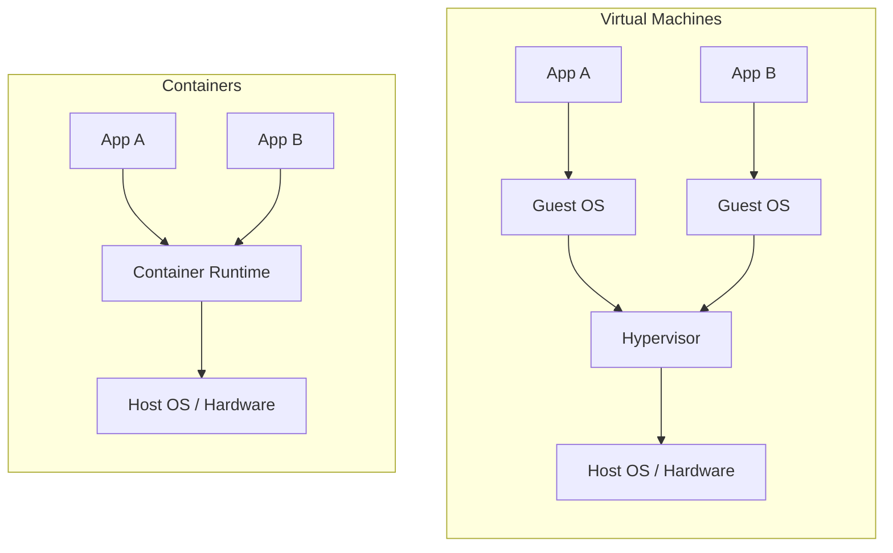
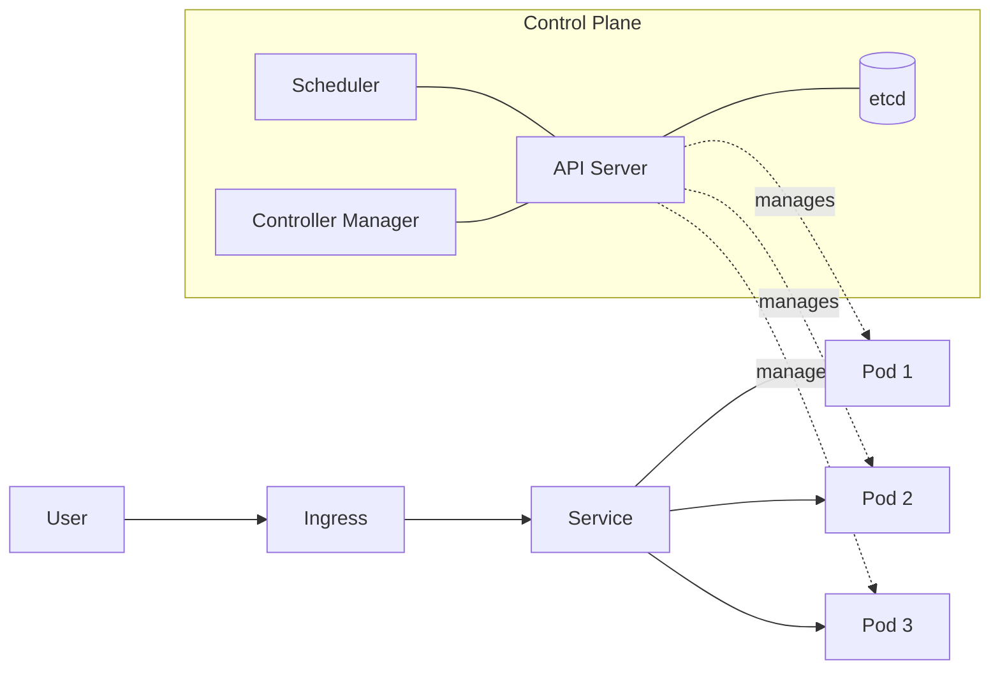
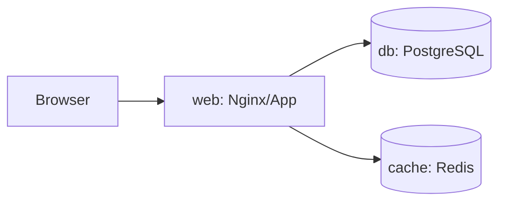

# Phase 2: Containers & Orchestration (Days 21–40)

  

Learn to package applications into containers, run them locally with Docker, and deploy, scale, and secure them with Kubernetes.

## Table of Contents

- [Prerequisites](#prerequisites)
- [Learning Objectives](#learning-objectives)
- [20-Day Schedule](#20-day-schedule)
- [Architecture Diagrams](#architecture-diagrams)
- [Hands-On Labs](#hands-on-labs)
- [Code Examples](#code-examples)
- [Best Practices](#best-practices)
- [Security](#security)
- [Real-World Use Cases](#real-world-use-cases)
- [Advanced Topics](#advanced-topics)
- [Self-Assessment](#self-assessment)
- [Tool Versions](#tool-versions)
- [Resources](#resources)
- [Completion Checklist](#completion-checklist)

## Prerequisites

- Basic software development practices (Git, HTTP, environment variables)
- Linux command-line basics (`ls`, `grep`, `curl`, `ps`, file permissions)
- Cloud computing concepts (VMs, networking, storage)
- A machine that can run Docker (Docker Desktop, or Docker Engine on Linux) and a local Kubernetes cluster (`kind`, `minikube`, or Docker Desktop's built-in cluster)

## Learning Objectives

By the end of this phase you will be able to:

| Objective | Why it matters |
|---|---|
| **Understand containers** | Containers give lightweight, portable environments that run the same everywhere, which reduces "works on my machine" deployment issues. |
| **Build and ship images** | Reproducible images are the unit of delivery for modern applications. |
| **Discover orchestration** | Orchestrators automate deployment, scaling, self-healing, and management of containerized apps. |
| **Deploy to Kubernetes** | Kubernetes is the industry-standard orchestrator. |
| **Secure the stack** | Image scanning, least privilege, and secrets handling prevent common production incidents. |

## 20-Day Schedule

| Days | Topic | Outcome |
|---|---|---|
| 21–22 | Container fundamentals: namespaces, cgroups, images vs. containers | Explain how containers differ from VMs |
| 23–25 | Docker basics: `run`, `exec`, `logs`, volumes, networks | Run and debug containers locally |
| 26–27 | Writing Dockerfiles, multi-stage builds, image optimization | Ship a small, cached, reproducible image |
| 28 | Docker Compose: multi-container apps | Run app + database + cache with one command |
| 29 | Registries and image tagging strategy | Push/pull images, use immutable tags |
| 30–31 | Kubernetes architecture: control plane, nodes, Pods | Describe the request flow inside a cluster |
| 32–33 | Workloads: Deployments, ReplicaSets, rolling updates, rollbacks | Deploy and update an app with zero downtime |
| 34 | Services, Ingress, and DNS | Expose an app inside and outside the cluster |
| 35 | ConfigMaps, Secrets, and persistent volumes | Separate config from code; persist state |
| 36 | Resource requests/limits, probes, autoscaling (HPA) | Make workloads resilient and right-sized |
| 37 | Container and cluster security | Scan images, apply RBAC and security contexts |
| 38 | Helm and Kustomize basics | Package and parameterize manifests |
| 39 | Advanced topics: service mesh, serverless on Kubernetes | Know when and why to use each |
| 40 | Capstone and review | Deploy a multi-service app end to end |

## Architecture Diagrams

### Container vs. VM



### Kubernetes request flow



### Multi-container app (Compose)



## Hands-On Labs

### Lab 1: Containerize a web app (Days 23–27)
1. Create a small web app (Node.js, Python Flask, or Go).
2. Write a `Dockerfile` using a multi-stage build.
3. Build, run, and verify with `curl http://localhost:8080`.
4. Compare image size before and after multi-stage optimization.

### Lab 2: Multi-container app with Docker Compose (Day 28)
1. Add a PostgreSQL database and Redis cache.
2. Wire services with a Compose network and environment variables.
3. Persist database data with a named volume.

### Lab 3: Deploy to Kubernetes (Days 32–36)
1. Create a local cluster with `kind create cluster`.
2. Apply a Deployment, Service, and ConfigMap.
3. Perform a rolling update, then roll back with `kubectl rollout undo`.
4. Add resource limits, probes, and an HPA.

### Lab 4: Secure the deployment (Day 37)
1. Scan your image with Trivy.
2. Run the container as non-root with a read-only filesystem.
3. Restrict traffic with a NetworkPolicy.

## Code Examples

### Multi-stage Dockerfile (Node.js)

```dockerfile
# ---- Build stage ----
FROM node:20-alpine AS build
WORKDIR /app
COPY package*.json ./
RUN npm ci
COPY . .
RUN npm run build

# ---- Runtime stage ----
FROM node:20-alpine
WORKDIR /app
ENV NODE_ENV=production
COPY --from=build /app/dist ./dist
COPY --from=build /app/package*.json ./
RUN npm ci --omit=dev && npm cache clean --force
USER node
EXPOSE 8080
CMD ["node", "dist/server.js"]
```

### Docker Compose

```yaml
services:
  web:
    build: .
    ports:
      - "8080:8080"
    environment:
      DATABASE_URL: postgres://app:secret@db:5432/appdb
      REDIS_URL: redis://cache:6379
    depends_on:
      db:
        condition: service_healthy
      cache:
        condition: service_started

  db:
    image: postgres:16-alpine
    environment:
      POSTGRES_USER: app
      POSTGRES_PASSWORD: secret   # demo only; use secrets in real environments
      POSTGRES_DB: appdb
    volumes:
      - db-data:/var/lib/postgresql/data
    healthcheck:
      test: ["CMD-SHELL", "pg_isready -U app -d appdb"]
      interval: 5s
      retries: 5

  cache:
    image: redis:7-alpine

volumes:
  db-data:
```

### Kubernetes Deployment (with limits, probes, security context)

```yaml
apiVersion: apps/v1
kind: Deployment
metadata:
  name: web
  labels:
    app: web
spec:
  replicas: 3
  strategy:
    type: RollingUpdate
    rollingUpdate:
      maxUnavailable: 1
      maxSurge: 1
  selector:
    matchLabels:
      app: web
  template:
    metadata:
      labels:
        app: web
    spec:
      containers:
        - name: web
          image: registry.example.com/web:1.0.0   # pin a version, avoid :latest
          ports:
            - containerPort: 8080
          resources:
            requests:
              cpu: "100m"
              memory: "128Mi"
            limits:
              cpu: "500m"
              memory: "256Mi"
          readinessProbe:
            httpGet:
              path: /healthz
              port: 8080
            initialDelaySeconds: 5
            periodSeconds: 10
          livenessProbe:
            httpGet:
              path: /healthz
              port: 8080
            initialDelaySeconds: 15
            periodSeconds: 20
          securityContext:
            runAsNonRoot: true
            allowPrivilegeEscalation: false
            readOnlyRootFilesystem: true
            capabilities:
              drop: ["ALL"]
```

### Service and Horizontal Pod Autoscaler

```yaml
apiVersion: v1
kind: Service
metadata:
  name: web
spec:
  selector:
    app: web
  ports:
    - port: 80
      targetPort: 8080
---
apiVersion: autoscaling/v2
kind: HorizontalPodAutoscaler
metadata:
  name: web
spec:
  scaleTargetRef:
    apiVersion: apps/v1
    kind: Deployment
    name: web
  minReplicas: 3
  maxReplicas: 10
  metrics:
    - type: Resource
      resource:
        name: cpu
        target:
          type: Utilization
          averageUtilization: 70
```

### Sample output

```console
$ docker build -t web:1.0.0 .
$ docker run -d -p 8080:8080 --name web web:1.0.0
$ docker ps
CONTAINER ID   IMAGE       COMMAND                 STATUS         PORTS                    NAMES
3f2a9c1b7d44   web:1.0.0   "node dist/server.js"   Up 5 seconds   0.0.0.0:8080->8080/tcp   web

$ kubectl get pods -l app=web
NAME                   READY   STATUS    RESTARTS   AGE
web-6d8f7c9b5d-4kxqz   1/1     Running   0          42s
web-6d8f7c9b5d-9tnwl   1/1     Running   0          42s
web-6d8f7c9b5d-m2vhc   1/1     Running   0          42s
```

### Essential commands

```bash
# Docker
docker build -t myapp:1.0.0 .
docker run -d -p 8080:8080 myapp:1.0.0
docker logs -f <container>
docker exec -it <container> sh
docker compose up -d --build

# Kubernetes
kubectl apply -f deployment.yaml
kubectl get pods,svc,deploy
kubectl describe pod <pod>
kubectl logs -f <pod>
kubectl rollout status deployment/web
kubectl rollout undo deployment/web
kubectl scale deployment/web --replicas=5
```

## Best Practices

- **Keep images updated.** Rebuild regularly to pick up base-image security patches.
- **Use multi-stage builds** to keep images small and free of build tooling.
- **Pin versions.** Use specific image tags (or digests) instead of `:latest`.
- **Add a `.dockerignore`** to keep secrets, `.git`, and build artifacts out of the build context.
- **Run one process per container** and log to stdout/stderr.
- **Set resource requests and limits** in Kubernetes to avoid resource contention.
- **Define readiness and liveness probes** so the cluster can route traffic and self-heal.
- **Never bake secrets into images.** Use Kubernetes Secrets or an external secret manager.
- **Treat manifests as code.** Version them in Git and review changes via pull requests.

## Security

### Image security
- Start from minimal, trusted base images (Alpine, distroless, or slim variants).
- Run as a non-root user.
- Scan images for vulnerabilities in CI.

### Cluster security
- Apply **RBAC** with least privilege.
- Enforce **Pod Security Standards** (`restricted` where possible).
- Use **NetworkPolicies** to limit Pod-to-Pod traffic.
- Encrypt Secrets at rest and avoid committing them to Git.

### Vulnerability scanning tools

| Tool | Purpose |
|---|---|
| [Trivy](https://trivy.dev/) | Image, filesystem, and IaC scanning |
| [Grype](https://github.com/anchore/grype) | Image vulnerability scanning |
| [Docker Scout](https://docs.docker.com/scout/) | Image analysis and policy |
| [kube-bench](https://github.com/aquasecurity/kube-bench) | CIS Kubernetes benchmark checks |
| [Falco](https://falco.org/) | Runtime threat detection |

```bash
trivy image web:1.0.0
```

## Real-World Use Cases

- **SaaS microservices:** each service ships as its own Docker image and scales independently.
- **CI/CD pipelines:** build, test, scan, and push images on every commit, then deploy to Kubernetes via rolling updates or GitOps (Argo CD, Flux).
- **Consistent dev environments:** Compose reproduces production dependencies locally.
- **Batch and scheduled jobs:** Kubernetes `Job` and `CronJob` resources run data processing on demand.

## Advanced Topics

- **Serverless on Kubernetes:** explore Knative for scale-to-zero and event-driven workloads.
- **Service meshes:** Istio or Linkerd for mTLS, traffic shaping, retries, and observability between microservices.
- **Packaging and delivery:** Helm charts, Kustomize overlays, GitOps workflows.
- **Observability:** Prometheus, Grafana, and OpenTelemetry for metrics, logs, and traces.
- **Policy as code:** OPA Gatekeeper or Kyverno to enforce cluster rules.

## Self-Assessment

1. What are the main benefits of using containers?
2. How does orchestration streamline application management?
3. What is the difference between an image and a container?
4. Why use multi-stage builds?
5. What is the difference between a Deployment and a Pod?
6. What happens when a readiness probe fails? A liveness probe?
7. Why set both resource requests and limits?

<details>
<summary>Suggested answers</summary>

1. Portability, consistency across environments, lightweight resource use, fast startup, and isolation.
2. It automates scheduling, scaling, self-healing, rolling updates, and service discovery across many hosts.
3. An image is an immutable template; a container is a running instance of an image.
4. They separate build tools from the runtime image, producing smaller and safer images.
5. A Pod is the smallest runnable unit; a Deployment manages replicated Pods, updates, and rollbacks.
6. Failed readiness removes the Pod from Service endpoints; failed liveness restarts the container.
7. Requests drive scheduling decisions; limits cap consumption to protect neighboring workloads.

</details>

## Tool Versions

The original outline pinned Docker 20.10.6 and Kubernetes 1.21.0. Both are long out of support and no longer receive security fixes, so use currently supported releases instead.

| Tool | Recommendation |
|---|---|
| Docker Engine / Desktop | Latest stable release |
| Kubernetes | A currently supported minor version (see [kubernetes.io/releases](https://kubernetes.io/releases/)) |
| kubectl | Within one minor version of your cluster |
| kind or minikube | Latest stable release |
| Helm | Latest stable 3.x or newer |

Check your setup:

```bash
docker version
kubectl version
kind version
helm version
```

## Resources

- [Docker Documentation](https://docs.docker.com/)
- [Kubernetes Documentation](https://kubernetes.io/docs/)
- [Kubernetes Tutorials](https://kubernetes.io/docs/tutorials/)
- [Play with Docker](https://labs.play-with-docker.com/)
- [Play with Kubernetes](https://labs.play-with-k8s.com/)
- [kind](https://kind.sigs.k8s.io/) and [minikube](https://minikube.sigs.k8s.io/)
- [Helm Docs](https://helm.sh/docs/)
- [CNCF Landscape](https://landscape.cncf.io/)
- Online courses on containerization and orchestration (Kubernetes certifications CKA/CKAD are a natural next step)

## Completion Checklist

- [ ] Explain containers vs. VMs
- [ ] Build an optimized multi-stage Docker image
- [ ] Run a multi-container app with Docker Compose
- [ ] Push an image to a registry
- [ ] Deploy an app to Kubernetes with a Deployment and Service
- [ ] Perform a rolling update and rollback
- [ ] Configure resource limits, probes, and an HPA
- [ ] Scan an image and fix findings
- [ ] Apply a non-root security context and a NetworkPolicy
- [ ] Complete the capstone project

---

**Next:** Phase 3, CI/CD and Infrastructure as Code
